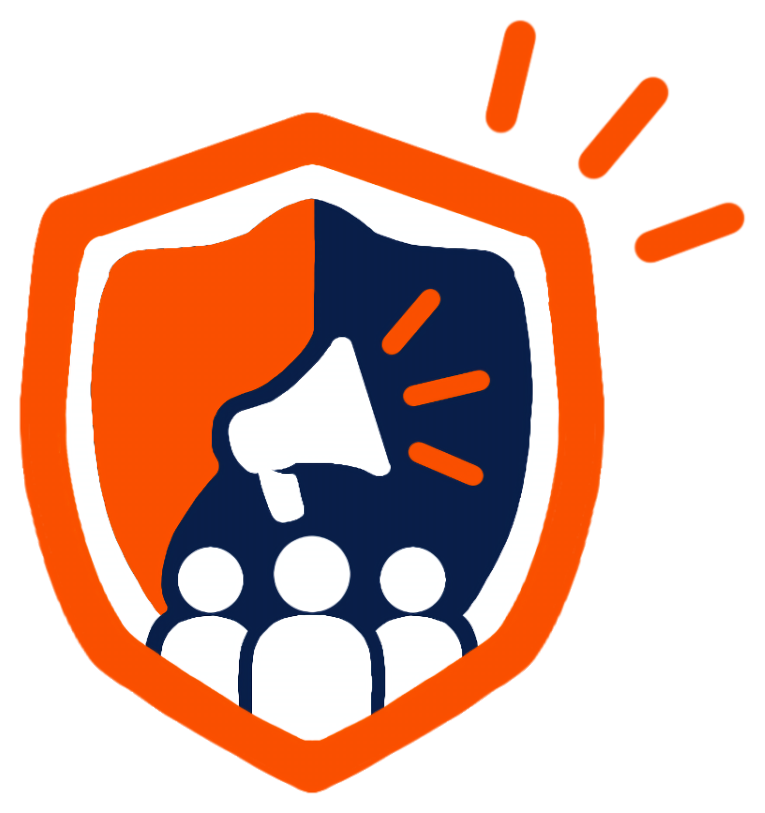

<div align="center">



# VozSegura

### Tecnologia a favor de uma escola mais segura e acolhedora.

Sistema web para registro, acompanhamento e gerenciamento de ocorrências de violência no ambiente escolar.

</div>

---

## Sobre o projeto

O **VozSegura** é um projeto acadêmico desenvolvido como Projeto Integrador do curso de Análise e Desenvolvimento de Sistemas.

A proposta é oferecer às instituições de ensino uma ferramenta digital para registrar ocorrências, acompanhar os relatos e apoiar a gestão escolar na identificação de situações que necessitam de atenção.

O sistema utiliza recursos de aprendizado de máquina para auxiliar na classificação da prioridade dos relatos.

## Funcionalidades

- Autenticação de usuários.
- Seleção da instituição de ensino.
- Acesso diferenciado para alunos e gestão escolar.
- Registro de ocorrências.
- Geração de protocolo para acompanhamento.
- Identificação de possíveis indícios de violência.
- Classificação de prioridade em Alta, Média ou Baixa.
- Painel de gestão para acompanhamento das ocorrências.
- Separação dos registros por instituição.

## Tecnologias utilizadas

| Tecnologia | Aplicação |
|---|---|
| HTML5 | Estrutura das páginas |
| CSS3 | Estilização das interfaces |
| JavaScript | Interatividade e funcionalidades |
| Node.js | Ambiente de execução |
| Express | API e rotas do servidor |
| MySQL | Banco de dados |
| Sequelize | Mapeamento objeto-relacional |
| Python | Processamento de dados |
| Scikit-learn | Aprendizado de máquina |
| Chart.js | Visualização de indicadores |

## Inteligência artificial

O VozSegura utiliza um modelo de aprendizado de máquina desenvolvido com Python e Scikit-learn.

O modelo auxilia na classificação da prioridade dos relatos em três categorias:

- **Alta**
- **Média**
- **Baixa**

A classificação é um recurso de apoio à análise e não substitui a avaliação e a atuação da equipe responsável pela instituição.

## Estrutura do projeto

```text
VozSegura/
├── assets/
│   ├── branding/
│   └── images/
├── dados/
├── machine-learning/
├── middleware/
├── models/
├── aluno.css
├── aluno.html
├── aluno.js
├── database.js
├── gestao.css
├── gestao.html
├── gestao.js
├── login.css
├── login.html
├── login.js
├── server.js
├── package.json
└── requirements.txt
```

## Como executar o projeto

### 1. Pré-requisitos

- Node.js e npm.
- Python 3.
- MySQL.
- Git.

### 2. Clonar o repositório

```bash
git clone https://github.com/rebeca-vital/VozSegura.git
cd VozSegura
```

### 3. Instalar as dependências do Node.js

```bash
npm install
```

### 4. Configurar as variáveis de ambiente

Crie um arquivo `.env` na raiz do projeto, utilizando o `.env.example` como referência.

Preencha com as configurações do seu ambiente:

```env
DB_NAME=nome_do_banco
DB_USER=seu_usuario
DB_PASSWORD=sua_senha
DB_HOST=localhost
JWT_SECRET=sua_chave_secreta
```

Não compartilhe o arquivo `.env` nem publique credenciais reais.

### 5. Instalar as dependências Python

No Windows:

```powershell
python -m venv .venv
.venv\Scripts\Activate.ps1
pip install -r requirements.txt
```

### 6. Configurar o banco de dados

Crie o banco de dados MySQL e configure as tabelas necessárias conforme os modelos disponíveis na pasta `models`.

### 7. Iniciar o servidor

```bash
node server.js
```

O servidor utiliza a porta 3001.

## Segurança e privacidade

O projeto utiliza autenticação e controle de acesso por perfil, além de organização dos registros por instituição.

O desenvolvimento considera a importância da proteção de dados pessoais e das diretrizes da Lei Geral de Proteção de Dados (LGPD).

A publicação do código-fonte não significa que dados reais de estudantes ou credenciais de acesso devam ser compartilhados.

## Status do projeto

Projeto acadêmico em desenvolvimento, com funcionalidades implementadas e etapas de finalização e documentação em andamento.

## Autoria

Desenvolvido como Projeto Integrador do curso de Análise e Desenvolvimento de Sistemas.

**Repositório:** [github.com/rebeca-vital/VozSegura](https://github.com/rebeca-vital/VozSegura)

---

<div align="center">

**VozSegura — Juntos por uma escola mais segura e acolhedora.**

</div>
